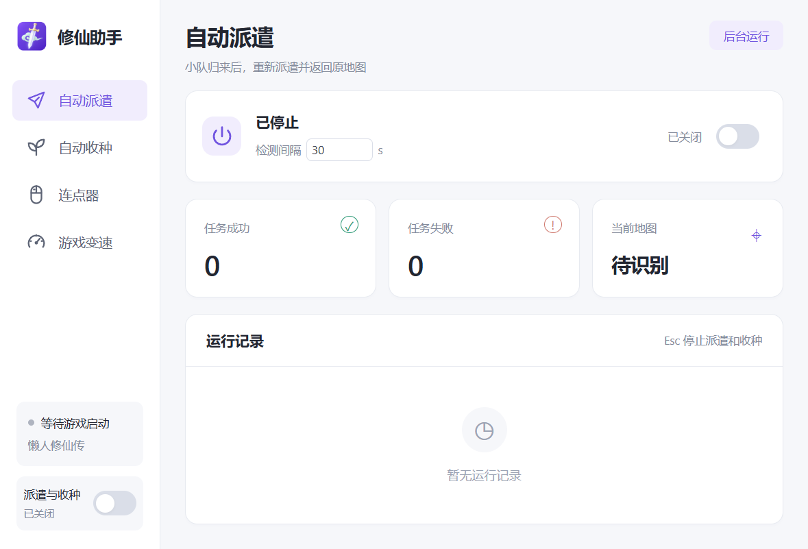
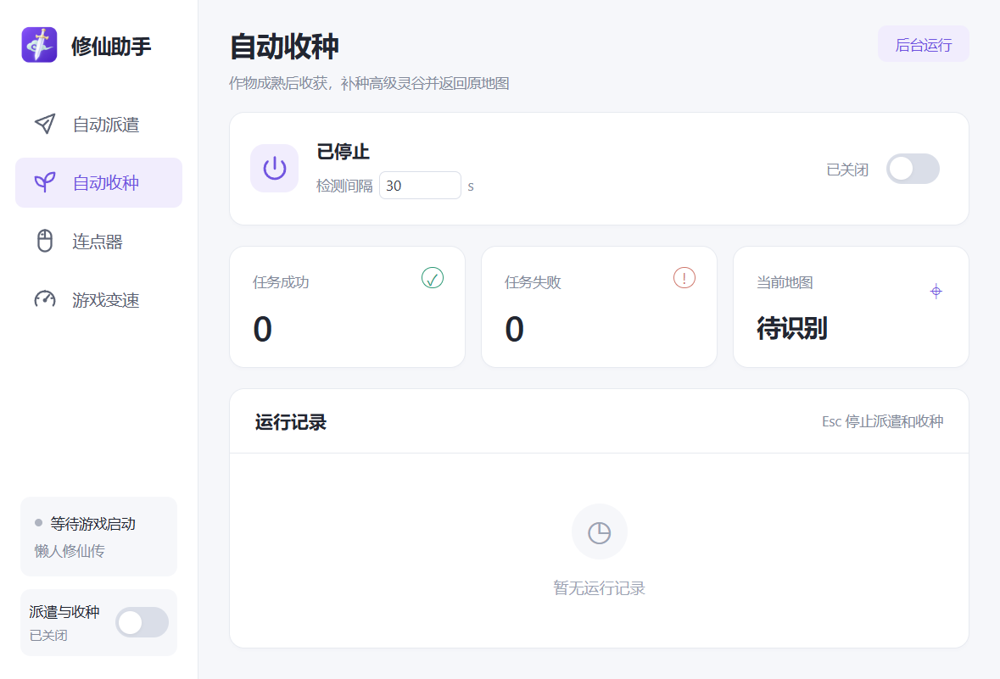
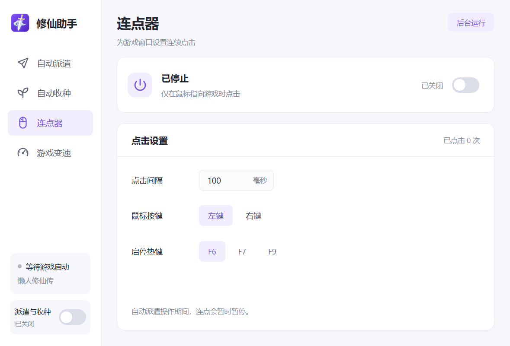
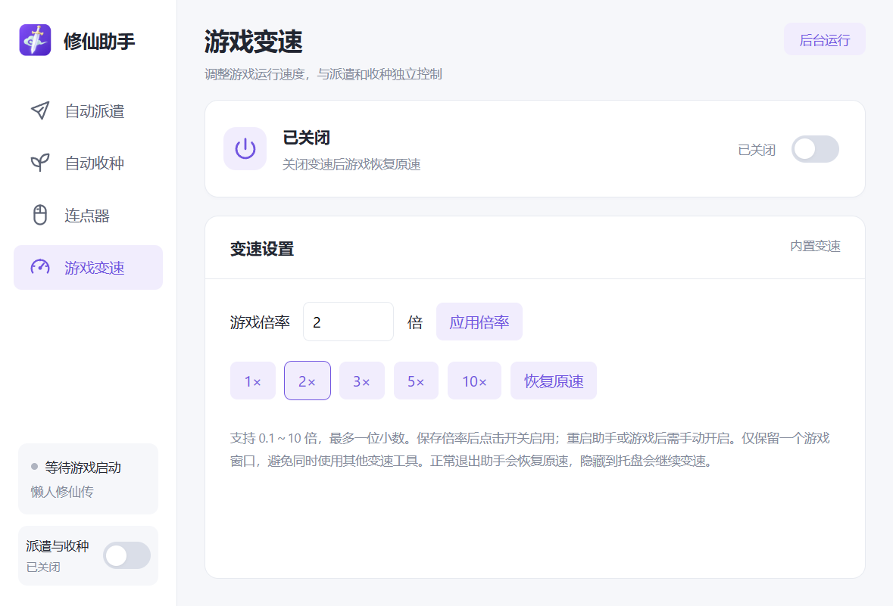

# 修仙助手

面向《懒人修仙传》Windows 客户端的桌面自动化工具，支持自动派遣、自动收种、连点器和内置游戏变速。

[下载最新版](https://github.com/Liang5757/auto-xiuxian/releases/latest) · [更新记录](CHANGELOG.md) · [使用说明](docs/usage.md) · [开发与发布](docs/development.md)

## 功能

| 功能 | 说明 |
| ---- | ---- |
| 自动派遣 | 收取返回的小队、重新派遣，再回到原挂机地图 |
| 自动收种 | 收获成熟作物、为空坑补种高级灵谷，再回到原挂机地图 |
| 连点器 | 支持左键、右键和全局热键，仅在鼠标指向游戏时点击 |
| 游戏变速 | 内置 32/64 位模块，支持 0.1～10 倍速及恢复原速 |

派遣与收种独立设置检测间隔、计数和日志，可用侧栏总开关统一启停；操作游戏时依次执行，并暂停连点。

## 截图

### 自动派遣



### 自动收种



### 连点器



### 游戏变速



## 使用

1. 从 Release 下载 Windows x64 EXE，双击运行并处理管理员确认提示。
2. 打开游戏，停留在原挂机地图的战斗页，开启自动派遣或自动收种。默认每 30 秒检查一次。
3. 连点器配置后开启，将鼠标指向游戏窗口；变速需先“应用倍率”，再开启独立开关。

所有功能启动时默认关闭，配置自动保存。首次在非时空原点地图使用时，按日志提示，在世界地图中将鼠标指向原地图图标并按 F8 标记回程位置。

关闭或最小化窗口会隐藏到托盘并继续运行；从托盘选择“退出”或在助手窗口按 Ctrl+Q 可完全退出。

| 热键 | 用途 |
| ---- | ---- |
| Esc | 停止派遣与收种 |
| F6 / F7 / F9 | 使用选定热键启停连点 |
| F8 | 按提示标记回程位置 |
| Ctrl+Q | 完全退出助手 |

变速时仅保留一个游戏窗口，避免同时使用其他变速工具。助手或游戏重启后需手动开启变速；关闭变速或正常退出助手会恢复原速。

## 开发

Electron + React + TypeScript 界面，Rust 自动化后台，原生游戏变速模块。

```powershell
npm ci
npx --no-install install-electron
rustup toolchain install 1.88.0 --profile minimal --component clippy --component rustfmt
npm run dev
```

`npm run check` 执行项目检查，`npm run build` 构建 Windows 便携包。目录结构、实现方式及发布流程见[开发与发布](docs/development.md)。
