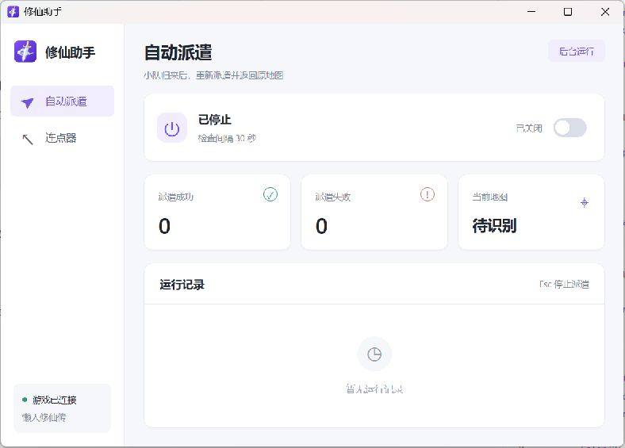

# 修仙助手

面向《懒人修仙传》Windows 客户端的桌面自动化工具。发现蛮荒小队返回后，自动前往蛮荒收取、重新派遣，再回到原挂机地图。

界面使用 Electron + React + TypeScript，后台使用 Rust，支持独立连点器、全局热键、系统托盘和运行记录。

[下载最新版本](https://github.com/Liang5757/auto-xiuxian/releases/latest) · [查看更新记录](CHANGELOG.md)

## 应用截图

### 自动派遣

提供派遣开关、成功与失败次数、当前地图和运行记录。



### 连点器

独立设置点击间隔、鼠标按键与启停热键。


## 下载与使用

1. 在 GitHub Releases 下载适用于 Windows x64 的 EXE。
2. 双击运行，并处理 Windows 管理员确认提示。
3. 打开游戏，停留在原挂机地图的战斗页。
4. 开启“自动派遣”，助手会立即检查一次，之后每 30 秒检查一次。
5. 如需连续点击，进入“连点器”设置参数后开启，将鼠标指向游戏窗口。

仓库为私有，下载需要登录有仓库访问权限的 GitHub 账号。每个 Release 同时提供 SHA256SUMS.txt，可用于核验下载文件。

自动派遣和连点器默认关闭。成功、失败计数及最近 100 条日志保存在本次运行中，完全退出后重新开始计数。

## 功能说明

### 自动派遣

一次检查按照以下顺序执行。

1. 定位游戏窗口，检查是否处于战斗页。
2. 识别小队返回的蓝色提示，有返回的小队才进入派遣流程。
3. 记录原地图，打开世界地图并进入蛮荒之地。
4. 检查三支小队的状态，收取已返回的小队。
5. 校验宠物列表变化及选中头像，重新派遣。
6. 核对出发状态，返回原挂机地图。

每轮操作只计一次成功或失败，空轮询不计数。失败后保持开关开启，等待 30 秒继续重试。上一轮未完成回程时，下一轮先尝试恢复原地图。

时空原点使用已知回程位置。首次在其他地图使用时，按运行记录提示，在世界地图中将鼠标指向原地图图标并按 F8。本次派遣会话内会缓存该位置。

### 连点器

- 点击间隔支持 30～60000 毫秒。
- 支持左键、右键，启停热键可选 F6、F7、F9。
- 仅在鼠标指向游戏所属窗口时点击。
- 自动派遣操作期间暂停连点，避免两个任务同时操作游戏。
- 运行时锁定参数设置，停止后可修改。

### 后台运行与退出

点击“后台运行”、最小化或关闭助手窗口都会隐藏到系统托盘，已开启的任务继续执行。双击托盘图标或再次打开 EXE，可恢复已有窗口。

从托盘菜单选择“退出”，或在助手窗口按 Ctrl+Q，可完全退出。退出时停止连点并等待当前派遣操作收尾。

| 热键         | 用途                           |
| ------------ | ------------------------------ |
| Esc          | 停止自动派遣                   |
| F6 / F7 / F9 | 使用连点器中选定的热键启停连点 |
| F8           | 按提示标记原地图的回程位置     |
| Ctrl+Q       | 在助手窗口中完全退出           |

游戏最小化时，助手会短暂还原游戏窗口进行检查，然后重新最小化。发行版请求管理员权限，用于操作管理员模式运行的游戏。

## 实现方式


### 界面与桌面外壳

React 负责页面、开关、参数和状态展示，每个组件的结构与 SCSS 样式放在同名目录中。Electron 主进程管理窗口、托盘、单实例恢复和 Rust 子进程。

页面通过 preload 暴露的有限接口发送命令，Electron 校验参数后再转发给 Rust。

### 进程通信与状态

Electron 启动 Rust 后台进程，通过标准输入发送 JSON 命令，通过标准输出接收响应与状态快照。请求带有编号，用于对应命令和返回结果。

Rust 的 app-server 管理运行状态、计数和日志，状态发生变化时推送快照。React 订阅快照更新界面，派遣和连点工作由后台线程执行。

### 截图、识图与点击

Rust 通过 Win32 API 定位游戏及其所属窗口，使用 GDI 获取画面，合成后归一化到参考尺寸。识图使用预存模板与局部图像匹配，同时检查返回提示区域的蓝色像素。

点击操作通过 Windows 窗口消息发送，并在关键步骤重新截图核对。识别模板位于 xiuxian-rs/core/src/refs/，游戏布局变化时需调整对应模板或坐标。

派遣与连点共享互斥锁，派遣检查期间连点线程等待。连点和热键监听独立于界面运行，隐藏窗口后仍可继续工作。

## 项目目录

```text
auto-xiuxian/
├─ desktop/
│  ├─ electron/                  Electron 主进程、preload 与通信
│  │  ├─ main.cjs                窗口、托盘、单实例与生命周期
│  │  ├─ engine.cjs              Rust 子进程通信
│  │  ├─ commands.cjs            页面命令校验
│  │  └─ preload.cjs             页面可调用的接口
│  ├─ src/
│  │  ├─ components/             React 组件和就近 SCSS
│  │  ├─ types.ts                前端命令与状态类型
│  │  └─ useEngineState.ts        后台状态订阅
│  └─ assets/                    应用图标
├─ xiuxian-rs/
│  ├─ core/                      派遣、识图、连点与窗口操作
│  ├─ app-server/                传输入口和后台状态管理
│  └─ app-server-protocol/        Rust 命令、请求与快照类型
├─ scripts/                      开发、检查与发布准备脚本
├─ design/                       图标源图、设计说明和应用截图
├─ .github/workflows/release.yml 标签发布工作流
├─ CHANGELOG.md                  版本更新记录
└─ package.json                  工作区统一命令
```

阅读界面可从 desktop/src/components/App/index.tsx 开始，派遣流程位于 xiuxian-rs/core/src/session.rs。

## 本地开发

需要 Windows x64、Node.js 22.12+、Rust MSVC 工具链，以及 Visual Studio C++ Build Tools 和 Windows SDK。项目使用的 Rust 版本固定在 xiuxian-rs/rust-toolchain.toml。

在仓库根目录执行。

```powershell
npm ci
npx --no-install install-electron
rustup toolchain install 1.88.0 --profile minimal --component clippy --component rustfmt
npm run dev
```

开发模式支持 React 热更新，使用独立的数据目录。需要操作管理员身份运行的游戏时，以管理员身份启动开发终端。

| 命令                 | 作用                                        |
| -------------------- | ------------------------------------------- |
| npm run dev          | 启动 Rust 后台、Vite 与 Electron            |
| npm run typecheck    | 检查 TypeScript 类型                        |
| npm run test:engine  | 运行 Rust 测试                              |
| npm run test:desktop | 构建后台并测试进程通信与命令校验            |
| npm run check        | 运行格式、函数长度、类型、Clippy 和回归测试 |
| npm run build        | 构建 Windows 便携版                         |

JavaScript、TypeScript 与 Rust 函数上限为 200 行，分别由检查脚本和 workspace Clippy 配置约束。

## 构建与发布

本地运行 npm run build 后，便携版位于 release/修仙助手.exe。该文件包含 Electron、React 页面、Rust 后台和应用图标，可独立分发。

发布新版本按以下步骤执行。

1. 同步根目录 package.json、desktop/package.json 和 xiuxian-rs/Cargo.toml 的版本，并刷新 npm、Cargo 锁文件。
2. 将 CHANGELOG.md 的未发布条目归档到对应版本，填写发布日期。
3. 运行 npm run check。
4. 使用 node scripts/prepare-release.mjs vX.Y.Z --check 校验版本与更新记录。
5. 提交到 main，再创建并推送 vX.Y.Z 标签。

GitHub Actions 会在 Windows 上执行检查、构建便携版、生成 SHA-256，并上传到草稿 Release，全部成功后正式发布。Actions 页面也可手动选择已有标签重新运行。已正式发布的版本拒绝覆盖，后续修复使用新版本号。

本地构建完成后，运行 npm run release:prepare -- vX.Y.Z，可生成 release/github/ 下的版本化 EXE、校验文件与发布说明。
