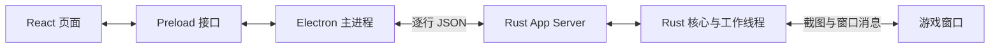

# 开发与发布

[返回首页](../README.md)

下列路径和命令均以仓库根目录为基准。

## 实现方式



### 界面与桌面外壳

React 负责页面、开关、参数和状态展示，每个组件的结构与 SCSS 样式放在同名目录中。Electron 主进程管理窗口、托盘、单实例恢复和 Rust 子进程。

页面通过 preload 暴露的有限接口发送命令，Electron 校验参数后再转发给 Rust。

### 进程通信与状态

Electron 启动 Rust 后台进程，通过标准输入发送 JSON 命令，通过标准输出接收响应与状态快照。请求带有编号，用于对应命令和返回结果。

Rust 的 app-server 管理运行状态、计数和日志，状态发生变化时推送快照。React 订阅快照更新界面，派遣、收种和连点工作由后台线程执行。游戏变速由 Electron 主进程管理独立的原生控制进程。

### 截图、识图与点击

Rust 通过 Win32 API 定位游戏及其所属窗口，使用 GDI 获取画面，合成后归一化到参考尺寸。识图使用预存模板与局部图像匹配，同时检查返回提示区域的蓝色像素。

点击操作通过 Windows 窗口消息发送，并在关键步骤重新截图核对。识别模板位于 xiuxian-rs/core/src/refs/，游戏布局变化时需调整对应模板或坐标。

派遣、收种与连点共享互斥锁，派遣与收种依次操作游戏，检查期间连点线程等待。连点和热键监听独立于界面运行，隐藏窗口后仍可继续工作。

## 项目目录

```text
auto-xiuxian/
├─ desktop/
│  ├─ electron/                  Electron 主进程、preload 与通信
│  │  ├─ main.cjs                窗口、托盘、单实例与生命周期
│  │  ├─ engine.cjs              Rust 子进程通信
│  │  ├─ commands.cjs            页面命令校验
│  │  └─ preload.cjs             页面可调用的接口
│  ├─ src/
│  │  ├─ components/             React 组件和就近 SCSS
│  │  ├─ types.ts                前端命令与状态类型
│  │  └─ useEngineState.ts        后台状态订阅
│  └─ assets/                    应用图标
├─ xiuxian-rs/
│  ├─ core/                      派遣、收种、识图、连点与窗口操作
│  ├─ app-server/                传输入口和后台状态管理
│  └─ app-server-protocol/        Rust 命令、请求与快照类型
├─ native/speed/                 游戏变速原生模块与 MinHook 源码
├─ scripts/                      开发、检查与发布准备脚本
├─ design/                       图标源图、设计说明和应用截图
├─ .github/workflows/release.yml 标签发布工作流
├─ CHANGELOG.md                  版本更新记录
└─ package.json                  工作区统一命令
```

阅读界面可从 desktop/src/components/App/index.tsx 开始，派遣流程位于 xiuxian-rs/core/src/session.rs。

## 本地开发

需要 Windows x64、Node.js 22.12+、Rust MSVC 工具链，以及 Visual Studio C++ Build Tools（含 x86/x64 构建工具）和 Windows SDK。项目使用的 Rust 版本固定在 xiuxian-rs/rust-toolchain.toml。

在仓库根目录执行。

```powershell
npm ci
npx --no-install install-electron
rustup toolchain install 1.88.0 --profile minimal --component clippy --component rustfmt
npm run dev
```

开发模式支持 React 热更新，使用独立的数据目录。需要操作管理员身份运行的游戏时，以管理员身份启动开发终端。

| 命令                 | 作用                                        |
| -------------------- | ------------------------------------------- |
| npm run dev          | 启动 Rust 后台、Vite 与 Electron            |
| npm run typecheck    | 检查 TypeScript 类型                        |
| npm run test:engine  | 运行 Rust 测试                              |
| npm run test:desktop | 构建后台并测试进程通信与命令校验            |
| npm run check        | 运行格式、函数长度、类型、Clippy、Rust/桌面/变速测试 |
| npm run build        | 构建 Windows 便携版                         |
| npm run build:speed  | 构建 x86/x64 游戏变速原生模块                |
| npm run test:speed   | 构建并测试双架构变速模块                    |

构建运行 `npm run build:speed`，需要 Visual Studio C++ x86/x64 构建工具。`npm run build` 和开发启动会自动编译；`npm run check` 包含双架构原生测试（倍率、计时连续性、控制进程异常退出恢复）。源码在 native/speed；MinHook v1.3.4 以源码静态编译，仅用于 Windows API 挂钩，无须安装任何外部工具，其许可证随包附带。

JavaScript、TypeScript 与 Rust 函数上限为 200 行，分别由检查脚本和 workspace Clippy 配置约束。

## 构建与发布

本地运行 npm run build 后，便携版位于 release/修仙助手.exe。该文件包含 Electron、React 页面、Rust 后台、游戏变速模块和应用图标，可独立分发。

每次 Windows 打包后，将最新版便携包复制到项目根目录并命名为 `修仙助手.exe`，核对其 SHA-256 与构建产物一致：

```powershell
Copy-Item -LiteralPath .\release\修仙助手.exe -Destination .\修仙助手.exe
Get-FileHash -Algorithm SHA256 -LiteralPath .\release\修仙助手.exe, .\修仙助手.exe
```

若根目录 EXE 被占用，先从托盘完全退出助手，再重新复制并校验。

发布新版本按以下步骤执行。

1. 同步根目录 package.json、desktop/package.json 和 xiuxian-rs/Cargo.toml 的版本，并刷新 npm、Cargo 锁文件。
2. 将 CHANGELOG.md 的未发布条目归档到对应版本，填写发布日期。
3. 运行 npm run check。
4. 使用 node scripts/prepare-release.mjs vX.Y.Z --check 校验版本与更新记录。
5. 提交到 main，再创建并推送 vX.Y.Z 标签。

GitHub Actions 会在 Windows 上执行检查、构建便携版、生成 SHA-256，并上传到草稿 Release，全部成功后正式发布。Actions 页面也可手动选择已有标签重新运行。已正式发布的版本拒绝覆盖，后续修复使用新版本号。

本地构建完成后，运行 npm run release:prepare -- vX.Y.Z，可生成 release/github/ 下的版本化 EXE、校验文件与发布说明。
